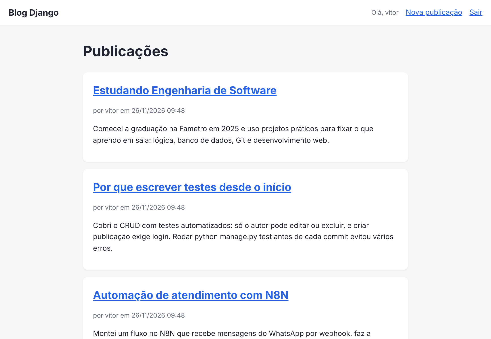
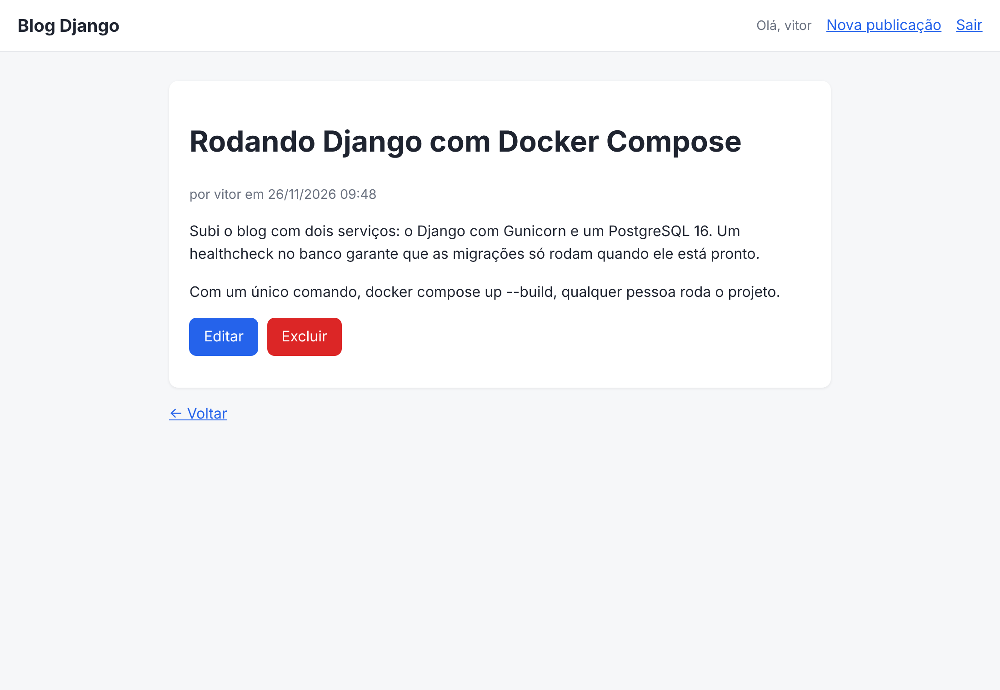
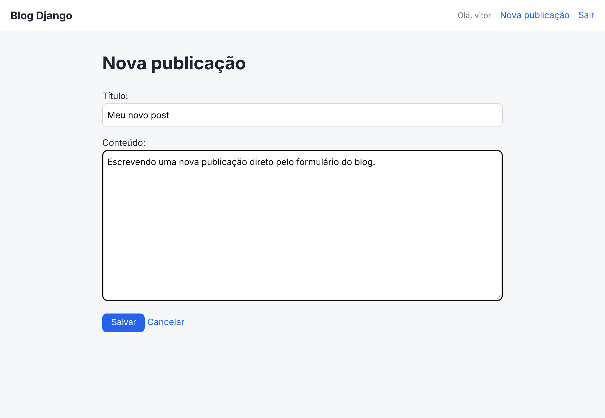
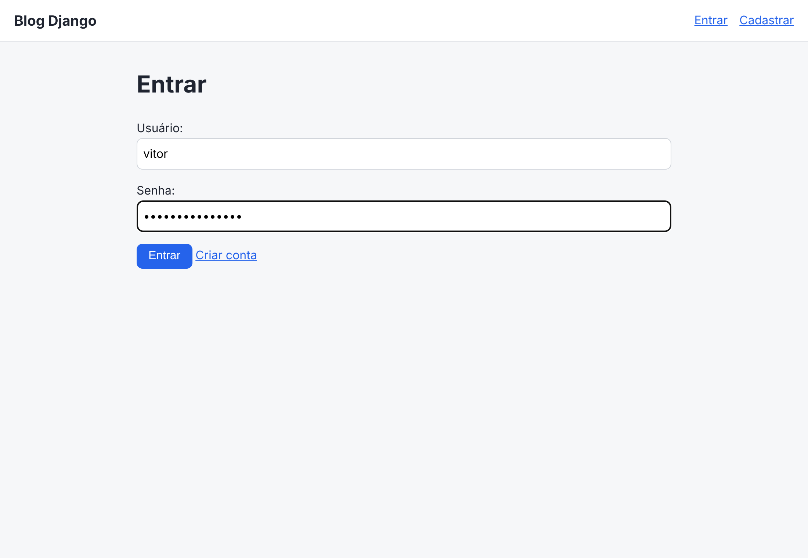

# Blog Django

Blog pessoal desenvolvido com **Django**, com cadastro de usuários e publicações (criar, listar, editar e excluir), banco de dados relacional e ambiente containerizado com **Docker Compose**.

## Funcionalidades

- Cadastro, login e logout de usuários
- CRUD de publicações (somente o autor edita ou exclui a própria publicação)
- Listagem paginada e página de detalhe
- Interface em HTML e CSS puros, responsiva
- Painel administrativo do Django (`/admin/`)
- Testes automatizados (`python manage.py test`)

## Capturas de tela

**Lista de publicações**



**Publicação com ações de editar e excluir (visíveis só para o autor)**



**Nova publicação**



**Login**



## Tecnologias

Python · Django · HTML/CSS · SQLite (desenvolvimento) · PostgreSQL (Docker) · Docker / Docker Compose · Gunicorn · Git/GitHub

## Como rodar

### Com Docker (PostgreSQL)

```bash
docker compose up --build
```

Acesse http://localhost:8000. Para criar um superusuário:

```bash
docker compose exec web python manage.py createsuperuser
```

### Localmente (SQLite)

```bash
python -m venv .venv && source .venv/bin/activate
pip install -r requirements.txt
python manage.py migrate
python manage.py runserver
```

### Testes

```bash
python manage.py test
```

## Estrutura

```
config/   configurações do projeto (settings, urls, wsgi)
blog/     app: models, views, forms, urls, templates, static e testes
```

## Autor

Vitor dos Santos Vasconcelos: [LinkedIn](https://linkedin.com/in/vitor-vasconcelos-03378a350)
